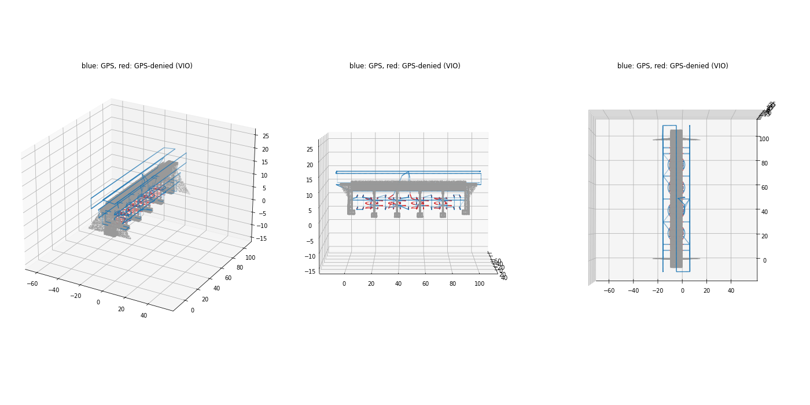
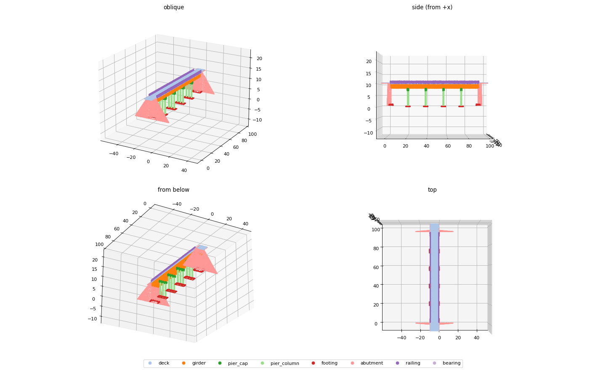

# Scene2_bridgeProject

Autonomous drone inspection of a 107 m multi-span girder bridge over a river, simulated in
**Gazebo Harmonic** with **ArduCopter SITL**. The drone (`iris_mapper`: Iris + 3D lidar +
RGB-D camera) flies a survey that is planned automatically from the bridge geometry, maps the
structure with lidar, and switches to visual odometry (VIO) when it flies under the deck where
GPS is lost.




## Repository layout

| Path | What it is |
|------|------------|
| `scene2_ardupilot.sdf` | Gazebo world: bridge (one labelled link per component), terrain, water, drone |
| `scene2_parts/` | One OBJ per bridge component + `parts.json` ground truth (class, label, bbox, centroid) |
| `scene2_tex/` | Merged textured meshes (bridge / env / water) from the rebuild step |
| `models/iris_mapper/` | Drone model: `iris_with_standoffs` + gimbal + lidar + RGB-D camera |
| `run_scene2_sim.sh` | Launch the world in Gazebo, or (`sitl`) ArduCopter SITL against it |
| `bridge_autonomy/` | Full autonomy stack: planner, GPS-denial simulator, VIO, mission, launcher |
| `bridge_autonomy/config/scene2.yaml` | The only config file; all geometry is derived from `parts.json` |
| `mapping/` | Lidar recorder (+ ROS 2 / RViz2 publishing), coverage evaluation, simpler survey scripts |
| `tools_scene2_rebuild.py` | Regenerates `scene2_parts/` and the bridge section of the world from the SketchUp sources |
| `source/` | Original SketchUp exports (`Scene-2.skp`, `.obj`, `.dae`, `.stl`) |
| `BRIDGE_PARTS_SPEC.md` | Component classes / label ids used in the world and `parts.json` |

Recorded maps go to `maps/scene2/` (git-ignored; a run produces several hundred MB).

## Tested environment

- Ubuntu 24.04
- Gazebo Harmonic (gz-sim 8.x)
- ArduPilot `master` (Aug 2026) built for SITL
- `ardupilot_gazebo` plugin (`main`)
- ROS 2 Jazzy (only for RViz2 visualisation)
- Python 3.12

## Setup

### 1. Gazebo Harmonic

```bash
sudo apt-get update && sudo apt-get install -y curl lsb-release gnupg
sudo curl https://packages.osrfoundation.org/gazebo.gpg --output /usr/share/keyrings/pkgs-osrf-archive-keyring.gpg
echo "deb [arch=$(dpkg --print-architecture) signed-by=/usr/share/keyrings/pkgs-osrf-archive-keyring.gpg] http://packages.osrfoundation.org/gazebo/ubuntu-stable $(lsb_release -cs) main" \
  | sudo tee /etc/apt/sources.list.d/gazebo-stable.list > /dev/null
sudo apt-get update && sudo apt-get install -y gz-harmonic
```

This also installs the Gazebo Python bindings (`gz.transport13`, `gz.msgs10`) used by the
recorder and VIO.

### 2. ArduPilot SITL

```bash
cd ~
git clone --recurse-submodules https://github.com/ArduPilot/ardupilot.git
cd ardupilot
Tools/environment_install/install-prereqs-ubuntu.sh -y
. ~/.profile                       # puts sim_vehicle.py and mavproxy on PATH
./waf configure --board sitl && ./waf copter
```

### 3. ardupilot_gazebo plugin

```bash
sudo apt-get install -y libgz-sim8-dev rapidjson-dev libopencv-dev \
  libgstreamer1.0-dev libgstreamer-plugins-base1.0-dev gstreamer1.0-plugins-bad gstreamer1.0-libav gstreamer1.0-gl
cd ~
git clone https://github.com/ArduPilot/ardupilot_gazebo.git
cd ardupilot_gazebo && mkdir -p build && cd build
cmake .. -DCMAKE_BUILD_TYPE=RelWithDebInfo && make -j$(nproc)
```

The scripts expect `~/ardupilot` and `~/ardupilot_gazebo`. If yours live elsewhere, edit
`sitl:` in `bridge_autonomy/config/scene2.yaml` and the paths in `run_scene2_sim.sh`.

### 4. ROS 2 Jazzy (optional, for RViz2)

Follow <https://docs.ros.org/en/jazzy/Installation/Ubuntu-Install-Debs.html> and install
`ros-jazzy-desktop`. Without it, run the mission with `--no-rviz`.

### 5. Python packages

```bash
sudo apt-get install -y python3-numpy python3-scipy python3-yaml python3-matplotlib python3-opencv
pip install --user --break-system-packages pymavlink   # also installed by ArduPilot's install-prereqs
```

### 6. Clone this repo

```bash
git clone https://github.com/Kshizo/Scene2_bridgeProject.git
cd Scene2_bridgeProject
chmod +x run_scene2_sim.sh mapping/run_scene2_mapping.sh
```

## Running

### Just the world + manual SITL

```bash
./run_scene2_sim.sh          # terminal 1: Gazebo GUI
./run_scene2_sim.sh sitl     # terminal 2: ArduCopter SITL + MAVProxy (map + console)
```

In MAVProxy: `mode guided`, `arm throttle`, `takeoff 5`.

### Full autonomous inspection mission

```bash
python3 bridge_autonomy/run_mission.py bridge_autonomy/config/scene2.yaml
```

This starts Gazebo, SITL (with parameters generated from the config and the drone model),
the GPS-denial simulator, VIO, the lidar recorder, RViz2 and the mission. Logs are written to
`maps/scene2/logs/`.

Options:
- `--replan` — re-run the survey planner (otherwise the cached `maps/scene2/plan.npz` is reused)
- `--no-gui` — headless Gazebo
- `--no-rviz` — no ROS 2 / RViz2
- `--stop` — kill every process of the stack

Plan only (writes `maps/scene2/plan.npz` + `plan.png`):

```bash
python3 bridge_autonomy/plan_survey.py bridge_autonomy/config/scene2.yaml --plot
```

### Score the map

```bash
python3 mapping/eval_coverage.py scene2_parts maps/scene2
```

Writes `coverage.json`, `map_labelled.npz`, `map.ply` and coverage renders into `maps/scene2/`.

### Simpler mapping run (no VIO / GPS denial)

```bash
mapping/run_scene2_mapping.sh        # Ctrl-C or `mapping/run_scene2_mapping.sh stop` to end
```

## How it works

- **Planner** (`plan_survey.py`): reads `parts.json`, builds an occupancy grid, and generates
  side passes at several heights, top pass, under-deck transverse passes, helices around each
  pier, column orbits and abutment passes. Paths are routed with A* and time-parameterised for
  smooth, continuous flight with speed reduced near structure.
- **GPS denial** (`gps_denial_sim.py`): disables SITL GPS (`SIM_GPS1_ENABLE`) whenever the drone
  is inside the deck footprint below the soffit.
- **VIO** (`vio.py`): RGB-D KLT tracking + PnP, sent to ArduPilot as `VISION_POSITION_ESTIMATE`.
  The mission switches EKF3 source sets (GPS ↔ external nav) with `MAV_CMD_SET_EKF_SOURCE_SET`
  ahead of the GPS-denied zone, and retreats along the path if VIO is lost.
- **Mapping** (`record_lidar.py`): lidar scans placed in the world frame with ground-truth pose
  and merged into a 3 cm voxel map, published to RViz2 coloured by component class.

## Troubleshooting

- **`Arm: Motors: Check frame class and type`** — newer ArduPilot no longer loads frame defaults
  with `--model JSON`; the scripts pass `copter.parm` and `gazebo-iris.parm` via `--add-param-file`.
- **Gyro-rate prearm failure** — with lidar + camera the sim runs below real time. The config
  sets `SCHED_LOOP_RATE 200` and `ARMING_SKIPCHK 16`.
- **Two Gazebo worlds interfere** — each stack uses `GZ_PARTITION=scene2`; give other sims a
  different partition.
- **`iris_with_standoffs` / `gimbal_small_3d` not found** — `GZ_SIM_RESOURCE_PATH` must include
  `~/ardupilot_gazebo/models` (the launch scripts set it).

## Regenerating the bridge from the SketchUp sources

```bash
python3 tools_scene2_rebuild.py source/Scene-2_structure.stl source/Scene-2.skp scene2_parts scene2_ardupilot.sdf
```
